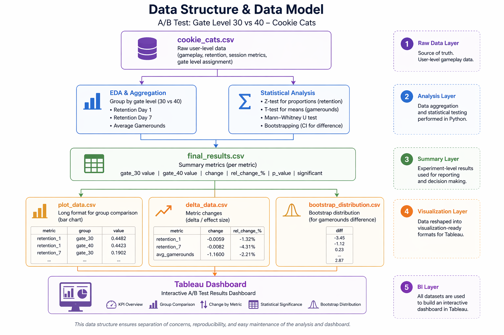
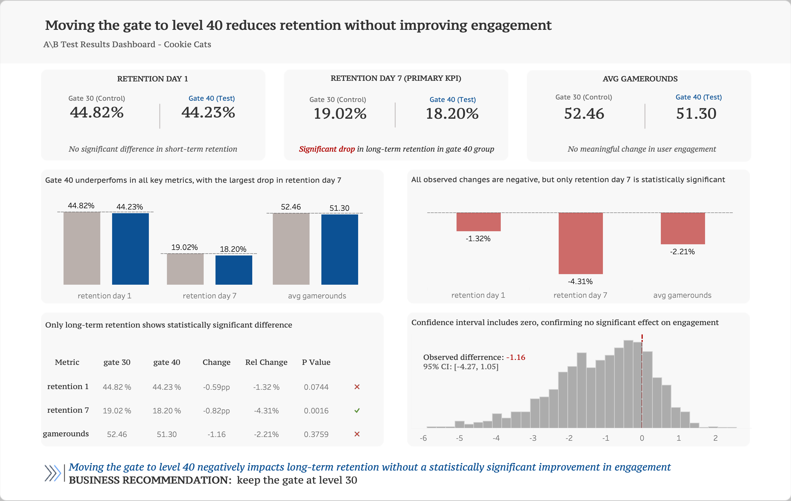

# `A/B Test Analysis`: Impact of Game Progression Gate on User Retention

## I. Project Background

This project presents an analysis of an **A/B test** conducted in the mobile game *Cookie Cats*.

The objective is to evaluate the impact of changing the **first game progression gate from level 30 to level 40** on:

* **User retention**
* **User engagement**

---

### Business Problem & Hypothesis

**Business question:**

Does moving the first game gate from **level 30 to level 40** affect **user retention and engagement**?

---

**Hypotheses:**

**Primary KPI: Day 7 Retention (`retention_7`)**

- H0: Day 7 retention is equal between the control (`gate_30`) and test (`gate_40`) groups.
- H1: Day 7 retention differs between the control (`gate_30`) and test (`gate_40`) groups.

**Secondary KPIs**

**1. Day 1 Retention (`retention_1`)**
- H0: Day 1 retention is equal between the control and test groups.
- H1: Day 1 retention differs between the control and test groups.

**2. Average Gamerounds (`sum_gamerounds`)**
- H0: The mean number of gamerounds is equal between the control and test groups.
- H1: The mean number of gamerounds differs between the control and test groups.

**Statistical significance level:** α = 0.05.

Day 7 retention is treated as the primary KPI for this portfolio analysis. Day 1 retention and average gamerounds are secondary KPIs used to provide additional context on short-term retention and user engagement.

---

**Business intuition:**

A later gate may increase **short-term engagement** by allowing uninterrupted gameplay, but it could negatively impact **retention** if players lose motivation or face delayed progression friction.

---

### Scope of Analysis

* Compare **control (gate_30)** and **test (gate_40)** groups
* Evaluate **Day 7 Retention (`retention_7`) as the primary KPI**, with Day 1 Retention (`retention_1`) and Average Gamerounds (`sum_gamerounds`) as secondary KPIs
* Apply statistical testing to validate observed differences between the control and test groups
* Quantify **effect size and business impact**
* Build a **Tableau dashboard** for result communication

---

## II. Data Structure & Data Model

The dataset includes **90,000+ records** and is structured at a **user level**.
This dataset is taken from [Kaggle](https://www.kaggle.com/datasets/mursideyarkin/mobile-games-ab-testing-cookie-cats).

The project follows a **layered data approach**:

* Raw data (user-level dataset)
* Aggregated metrics and statistical analysis in Python
* Visualization-ready datasets for Tableau
* Final dashboard for business insights

---

### Data Preparation Workflow

**Python (Pandas)**

* Data cleaning and validation
* Metric calculation (**retention rates, average gamerounds**)
* Aggregation by experiment group
* Statistical testing:

  * Z-test (proportions)
  * T-test (means)
  * Mann–Whitney U test (distribution comparison)
  * Bootstrapping (confidence intervals)
* Creation of **summary and visualization datasets**

---

**Tableau**

* KPI visualization (**retention and engagement**)
* Group comparison charts
* Effect size (**delta**) visualization
* Statistical significance table
* Bootstrap distribution visualization

---

## III. Executive Summary

### Tableau Dashboard

Click the [Tableau Public dashboard](https://surl.lu/qicavv) to explore **interactive filters and drill-downs**.

---

### Business Impact

> The analysis found **a statistically significant decrease in Day 7 retention when the gate was moved from level 30 to level 40**. No statistically significant differences were detected in Day 1 retention or average gamerounds.

---

### Key Findings

* **Retention Day 1:** No statistically significant difference
* **Retention Day 7:** **Statistically significant decrease** in the test group
* **Engagement (gamerounds):** No significant difference between groups
* All observed changes are negative, but only **long-term retention** shows statistical significance

---

### Strategic Interpretation

The results suggest that **moving the first gate from level 30 to level 40 may negatively affect long-term retention** without producing a statistically significant change in short-term retention or average gamerounds.

The experiment does not establish why Day 7 retention decreased. Further analysis of player behavior or qualitative UX feedback could help investigate the underlying reasons.

---

### Strategic Insights

* Moving the first gate to level 40 was associated with lower Day 7 retention in this experiment.
* Changes to game progression should be evaluated against **long-term retention**, not engagement metrics alone.

---

## IV. Strategic Recommendations

* **Maintain the gate at level 30**
* Avoid delaying early progression barriers without clear engagement benefits
* Prioritize experiments that improve **long-term retention**
* Complement A/B testing with **qualitative insights** (player behavior, UX feedback)

---

 

*Technical summary of tools and analytical methods used in this project*:

* Tools: Python (Pandas), Jupyter Notebook, Tableau
* Analytical Techniques: Descriptive analysis, Z-test for proportions, T-test (Welch), Mann–Whitney U test, Bootstrapping (confidence intervals)
* Key Metrics: Retention Day 1 (retention_1), Retention Day 7 (retention_7), Average gamerounds (engagement)
